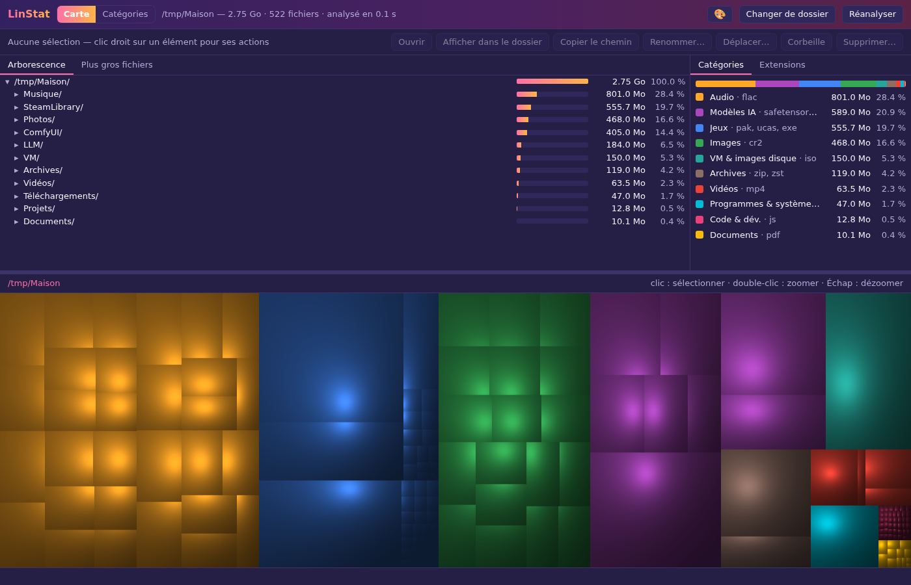
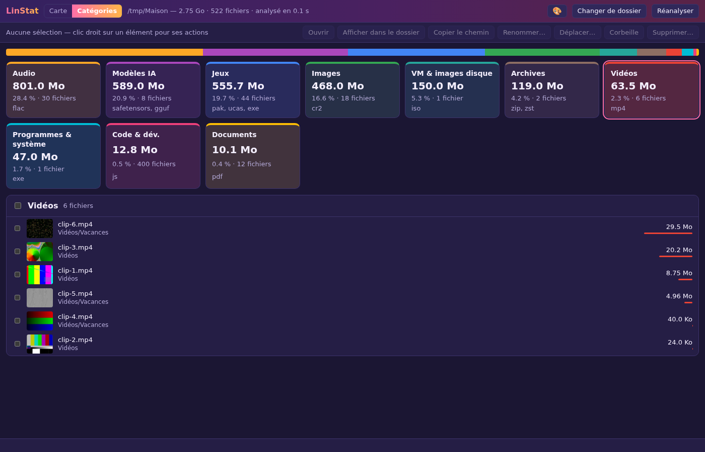
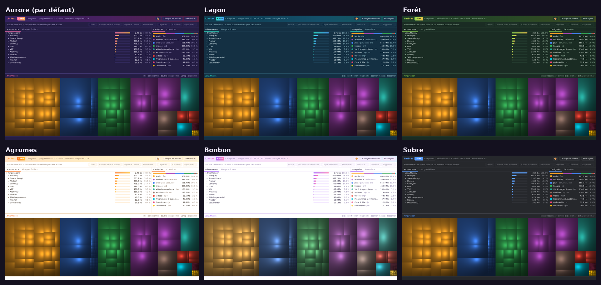

# LinStat

Un WinDirStat pour Linux : voir d'un coup d'œil ce qui prend de la place sur le disque,
et faire le ménage dans la foulée.

<p align="center">
  
</p>

<p align="center">
  
</p>

*Captures réalisées sur un dossier de démonstration.*

## Ce qu'il fait

- **Carte façon WinDirStat** : chaque rectangle est un fichier, sa surface est proportionnelle
  à sa taille, avec l'ombrage « en coussins » qui fait ressortir les dossiers. Double-clic pour
  zoomer, Échap pour revenir.
- **Arborescence** triée par taille et liste des **plus gros fichiers**.
- **Catégories** : Modèles IA, Jeux, Vidéos, Images, Audio, Documents, Archives, VM & images
  disque, Code & dév., Caches, Corbeille… La carte se colore par catégorie ou par extension.
- **Vue Catégories** : une carte par catégorie, puis ses 250 plus gros fichiers avec
  **miniatures** (images et vidéos) et cases à cocher pour agir sur plusieurs fichiers à la fois.
- **Gestion des fichiers** (barre d'actions ou clic droit) : ouvrir, afficher dans Dolphin,
  copier le chemin, renommer (F2), déplacer, **mettre à la corbeille** (Suppr) ou supprimer
  définitivement (Maj+Suppr). La carte et les totaux se mettent à jour sans réanalyse.

## Thèmes

Sept thèmes au choix avec le bouton 🎨, retenus d'un lancement à l'autre
(`~/.config/linstat/config.json`) : **Aurore** (par défaut), **Lagon**, **Forêt**, **Agrumes**
et **Bonbon** (clairs), et les plus sobres **Sobre** et **Clair**. Bonbon adoucit aussi les
couleurs de la carte en pastel.

<p align="center">
  
</p>

## Rapide

Dossier personnel de 2,4 millions de fichiers analysé en environ 3,5 s, disque entier de
3,2 millions de fichiers en moins de 10 s (`du -sx` met deux fois plus longtemps).

- **Plusieurs processus** plutôt que des threads : `lstat()` est trop court pour que des
  threads Python gagnent quoi que ce soit, ils passent leur temps à se disputer le GIL.
- **Découpage par budget** : chaque tâche explore au plus 40 000 entrées puis rend le reste,
  si bien qu'un énorme dossier se répartit lui aussi sur tous les cœurs.
- **Mémoire sobre** : seul un fichier sur ~50 000 est assez gros pour apparaître sur la carte ;
  les autres sont seulement comptés, pas gardés un par un.

## Catégories

Un fichier est classé d'abord **par son emplacement**, puis par son extension : un jeu contient
des `.dll` et des `.mp4`, un modèle Ollama n'a pas d'extension. Exemples de règles :
`~/Games`, Steam, Lutris, Heroic, Bottles → Jeux ; `~/models`, LM Studio, Ollama, Hugging Face,
ComfyUI → Modèles IA ; `~/.cache` → Caches ; la corbeille → Corbeille.

Les règles sont dans `PATH_RULES` et les extensions dans `CATEGORIES`, en haut de `linstat.py`.
Une règle plus profonde l'emporte ; *Code & dév.* et *Caches* ne s'appliquent que si rien
d'autre n'a été décidé, et rien n'écrase *Corbeille*.

## Sécurité

- **Corbeille d'abord** : « Corbeille » utilise celle du bureau (restaurable depuis Dolphin) ;
  la suppression définitive demande une confirmation où « Annuler » est le bouton par défaut.
- LinStat refuse de toucher au dossier analysé lui-même, à ce qui est en dehors, et aux
  autres disques montés. Supprimer un lien symbolique ne supprime jamais sa cible.
- Le serveur local n'écoute que sur `127.0.0.1`, exige un en-tête propre à LinStat et vérifie
  l'en-tête `Host` : un site web ouvert à côté ne peut ni lire l'analyse ni piloter les fichiers.

## Installation

Dépendances : **Python 3**, et pour la fenêtre native **GTK 4 + WebKitGTK 6**
(Arch / CachyOS : `sudo pacman -S python-gobject webkitgtk-6.0`). Sans elles, LinStat s'ouvre
dans le navigateur. Optionnel : `python-pillow` et `ffmpegthumbnailer` pour les miniatures.

```bash
git clone https://github.com/BiasedMonkey/linstat.git
cd linstat
./install.sh
```

Le script copie l'appli dans `~/.local/share/linstat/` et ajoute « LinStat » au menu, avec
deux actions au clic droit : analyser le dossier personnel ou tout le disque.
`./install.sh --favori` l'ajoute en plus aux favoris du menu KDE.

Pour essayer sans installer : `python3 linstat.py [dossier]` (`--browser` pour le navigateur).

## Bon à savoir

- **btrfs** : chaque sous-volume (`/home`, `/var/log`…) a son propre numéro de périphérique.
  LinStat compare donc la *source* des montages pour ne pas « oublier » `/home` en analysant `/`.
- Les tailles sont celles **occupées sur le disque** (blocs alloués), pas la taille apparente.
  Sur btrfs, la compression et les données partagées ne sont pas visibles ainsi : le total
  peut dépasser l'espace réellement utilisé, mais les proportions restent justes.
- Les liens physiques ne sont comptés qu'une fois.

## Vérifier

```bash
python3 tests/verifier.py
```

Teste dans un dossier temporaire : totaux exacts face à une référence simple (liens
physiques, arborescence de 1 200 niveaux), règles de catégories, et toutes les opérations
sur les fichiers, y compris ce qui doit être refusé.

## Outils

- `outils/captures.sh` : régénère les captures du README sur un dossier de démonstration
  créé en mémoire dans `/tmp` (nécessite ffmpeg, Chromium et python-pillow).
